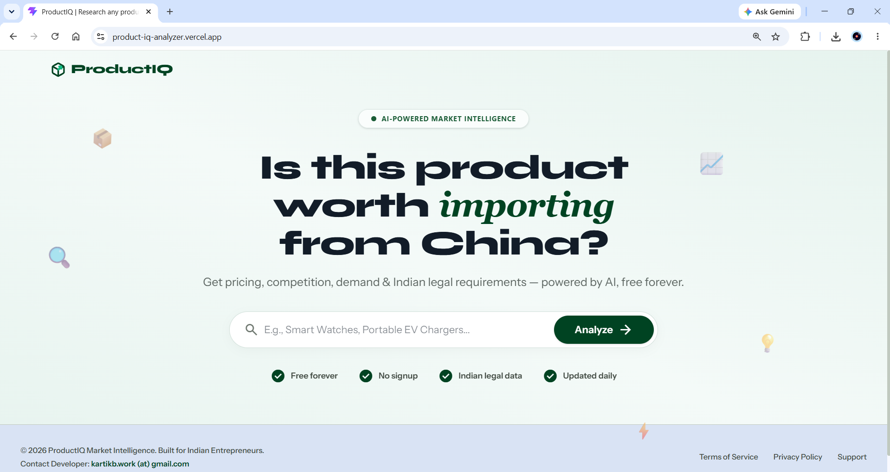

# 📦 ProductIQ

### AI-powered market intelligence for Indian importers & e-commerce sellers

Type a product name. Get pricing, margins, legal compliance, competitor data, demand trends, and a straight **BUY / CAUTION / SKIP** verdict — before you spend a rupee on stock.

<p align="center">
  <a href="https://product-iq-analyzer.vercel.app/"></a>
  <a href="#-getting-started"></a>
  <a href="./DEPLOYMENT.md"></a>
</p>

<p align="center">
  
  
  
  
  
  
  
  
</p>

---

### 📑 Table of Contents

- [What it does](#-what-it-does)
- [Screenshots & Demo](#-screenshots--demo)
- [Tech Stack](#️-tech-stack)
- [Architecture & Engineering](#-architecture--engineering)
- [Project Structure](#-project-structure)
- [API Endpoints](#-api-endpoints)
- [Getting Started](#-getting-started)
- [Testing & Benchmarking](#-testing--benchmarking)
- [Deployment](#-deployment)
- [License](#-license)

---

## 🧠 What it does

Give it a product name, and ProductIQ returns a structured report containing:

| Feature | Description | Feature | Description |
|---|---|---|---|
| 🎯 **IQ Score & Verdict** | BUY / CAUTION / SKIP recommendation with rationale | 📊 **Market Performance** | Category, market size, rating, review volume, demand level and entry difficulty |
| 💰 **Pricing & Margins** | Landed cost, GST, customs, MSRP, gross margin, ROI and break-even analysis | ⚖️ **Legal & Compliance** | BIS certification, HSN code, GST, DGFT status and compliance checklist |
| 🏆 **Competitive Landscape** | Platform-wise listings, brand market share and competing products | 🧩 **Variants & Features** | Common variants and product feature comparisons |
| 📈 **Demand Trends** | Google Trends interest-over-time data | 🍂 **Seasonality** | Seasonality insights and timing recommendations |
| 🧭 **SWOT Analysis** | Strengths, weaknesses, opportunities and threats | 💡 **Strategy Advice** | Actionable product-entry recommendations |

Reports are cached using **Upstash Redis** and persisted in **Supabase**, allowing faster repeat lookups and historical report retrieval.

---

## 🖼️ Screenshots & Demo

<p align="center">
  <a href="https://drive.google.com/file/d/14r89F1socSBz19faL6eSfEb-6ckjQy5-/view?usp=sharing">
    
    <br/>
    
  </a>
</p>

<details>
<summary><b>📷 Click to expand the full UI walkthrough</b></summary>

**Search / Landing Page**


**Report Generation Progress**


**Market Report Overview**


</details>

---

## ⚙️ Tech Stack

<div align="center">

| Layer | Stack |
|---|---|
| **Frontend** | React 19 · Vite 8 · Tailwind CSS 4 · Recharts · jsPDF · Axios |
| **Backend** | FastAPI · Python · Pydantic · Google Gemini · Serper.dev · pytrends |
| **Data & Storage** | Supabase · Upstash Redis |
| **Testing** | Pytest · Python unit testing |
| **Hosting** | Vercel (frontend) · Render (backend) |

</div>

> Designed to run with a zero/low-cost infrastructure using free-tier services wherever possible.

---

## 🏗️ Architecture & Engineering

### 1. Multi-source data aggregation

ProductIQ combines multiple sources to build product intelligence:

- **Serper.dev:** Product listings, competitor information, pricing and reviews.
- **Google Trends:** Relative search-interest data and demand patterns.
- **Local compliance dataset:** Product-category-based legal and regulatory reference information.
- **Google Gemini:** Structured report generation and market analysis.

Data collection from external sources is performed concurrently to reduce report-generation latency.

### 2. Cache-first report retrieval

The report retrieval pipeline follows:

**Redis → Supabase → Fresh Report Generation**

- **Redis:** Fast retrieval of recently requested reports.
- **Supabase:** Persistent report storage and historical retrieval.
- **Fresh generation:** Collects current available data and generates a new report when no valid cached report is available.

Reports include generation and expiry information. Supabase records are checked for freshness, with the freshness period configurable through `REPORT_FRESHNESS_DAYS` (default: 30 days).

Redis uses a separate cache TTL of 24 hours. This allows frequently accessed reports to be served quickly while maintaining a longer-lived persistent report history.

### 3. Financial calculations

Financial metrics are calculated using dedicated Python utility functions rather than relying entirely on AI-generated arithmetic.

The calculations cover:

- Customs duty and applicable tax components.
- GST calculations.
- Total landed cost.
- Gross margin and net profit.
- Return on investment (ROI).
- Break-even analysis.

Gemini assists with market interpretation and estimates for relevant inputs, while Python handles the deterministic calculations.

**Note:** Market prices, demand, duties and other source-dependent inputs may be estimates. Financial calculations depend on the accuracy of those inputs and should be independently verified before making purchasing decisions.

### 4. Demand trend data reliability

Google Trends provides relative search-interest values rather than absolute search volumes.

When live trend data is unavailable, the application can use simulated fallback data. Trend data includes provenance information so actual Google Trends observations can be distinguished from simulated values.

### 5. Report validation and reliability

- Pydantic models validate the structure of generated market reports.
- Python utility functions isolate financial calculations.
- Report freshness metadata helps prevent indefinitely serving outdated reports.
- Automated tests cover core calculation and utility behavior.
- Benchmarking helps evaluate report-generation performance.

---

## 🗂️ Project Structure

<details>
<summary><b>Click to expand the directory tree</b></summary>

```text
ProductIQ/
├── backend/
│   ├── main.py                 # FastAPI application and API endpoints
│   ├── report_utils.py         # Financial calculations and utility functions
│   ├── benchmark_report.py     # API performance benchmarking
│   ├── legal_data.json         # Static BIS/HSN/GST/DGFT reference data
│   ├── requirements.txt        # Production dependencies
│   ├── requirements-dev.txt    # Development and testing dependencies
│   ├── Dockerfile
│   └── tests/
│       ├── conftest.py
│       └── test_report_utils.py
│
├── frontend/
│   ├── src/
│   │   ├── App.jsx
│   │   └── ...
│   ├── package.json
│   └── vite.config.js
│
├── ProductIQ UI/               # Design references and UI screens
├── schema.sql                  # Supabase database schema
├── DEPLOYMENT.md               # Deployment guide
└── README.md
```

</details>

---

## 🔌 API Endpoints

| Method | Endpoint | Description |
|---|---|---|
| `GET` | `/api/ping` | Health check |
| `POST` | `/api/analyze` | Analyze a product and return a structured `MarketReport` |
| `GET` | `/api/history` | Retrieve previously analyzed products |

### Report generation workflow

`POST /api/analyze` follows a cache-first workflow:

1. Check Redis for a cached report.
2. If unavailable, check Supabase for a persisted report.
3. Validate report freshness before returning stored data.
4. If the report is missing or expired, fetch product information and demand trends.
5. Generate a structured report using Gemini.
6. Validate the report and calculate financial metrics using Python utilities.
7. Persist the report and refresh the cache.

---

## 🚀 Getting Started

### Prerequisites

- Python 3.10+
- Node.js 18+
- API keys for Google Gemini, Serper.dev, Supabase and Upstash Redis.

### 1️⃣ Clone the repository

```bash
git clone https://github.com/kartikbansalx/ProductIQ.git
cd ProductIQ
```

### 2️⃣ Backend setup

```bash
cd backend

python -m venv .venv

# Windows
.venv\Scripts\activate

# macOS / Linux
source .venv/bin/activate

pip install -r requirements.txt
```

Create a `.env` file in the backend directory (or the configured environment-file location):

```env
GEMINI_API_KEY=your_gemini_key
SERPER_API_KEY=your_serper_key
SUPABASE_URL=your_supabase_url
SUPABASE_ANON_KEY=your_supabase_anon_key
UPSTASH_URL=your_upstash_url
UPSTASH_TOKEN=your_upstash_token

REPORT_FRESHNESS_DAYS=30
```

Configure the Supabase database using the schema and migration instructions in `schema.sql`. Back up existing data before applying schema changes.

Start the backend:

```bash
uvicorn main:app --host 0.0.0.0 --port 8000 --reload
```

### 3️⃣ Frontend setup

Open another terminal:

```bash
cd frontend
npm install
```

Create a `.env` file inside `frontend/`:

```env
VITE_BACKEND_URL=http://localhost:8000
```

Start the frontend:

```bash
npm run dev
```

---

## 🧪 Testing & Benchmarking

ProductIQ includes a development testing setup for validating core backend utilities and measuring API performance.

### Install development dependencies

```bash
cd backend
pip install -r requirements-dev.txt
```

### Run tests

```bash
pytest -q
```

### Benchmark report generation

Start the backend, then run:

```bash
python benchmark_report.py "smartwatch" --base-url http://127.0.0.1:8000 --runs 3
```

The benchmark helps measure API response performance across repeated requests.

For meaningful comparisons, distinguish cache-hit requests from fresh report-generation requests. Repeated requests for the same product may be served from Redis or Supabase rather than triggering a new generation.

---

## ☁️ Deployment

ProductIQ is designed to deploy using:

- **Backend:** [Render](https://render.com) — Python web service or Docker.
- **Frontend:** [Vercel](https://vercel.com) — Vite static build.
- **Database:** Supabase.
- **Cache:** Upstash Redis.

Live application: **[product-iq-analyzer.vercel.app](https://product-iq-analyzer.vercel.app/)**

Full deployment instructions, environment variables, database configuration and service setup are available in **[DEPLOYMENT.md](./DEPLOYMENT.md)**.

Keep all API keys and service credentials in environment variables. Never commit `.env` files or expose backend secrets in frontend code.

---

## 📄 License

This project currently has no explicit license. Contact the repository owner before reuse or distribution.

---

<div align="center">
  <sub>Built by <a href="https://github.com/kartikbansalx">Kartik Bansal</a></sub>
</div>
